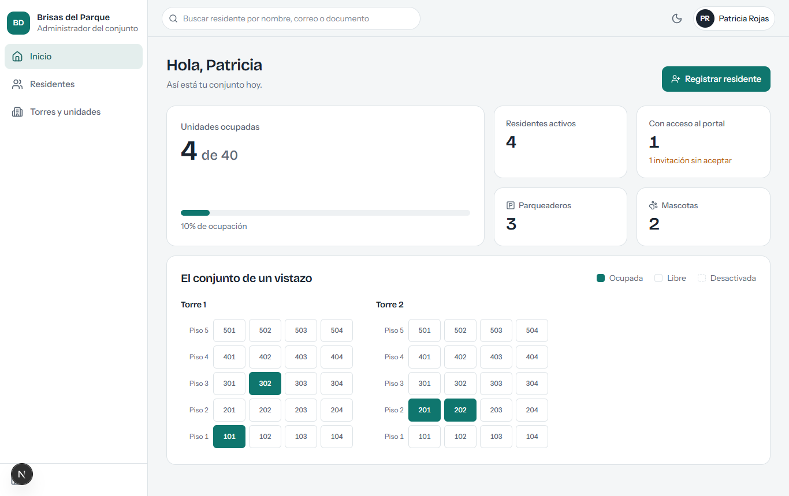
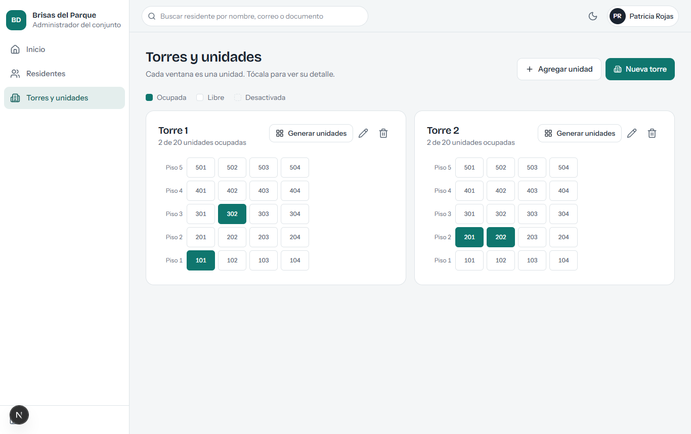
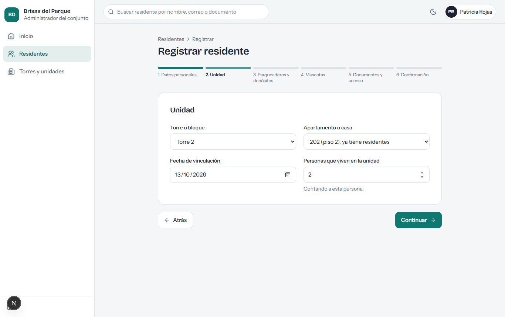
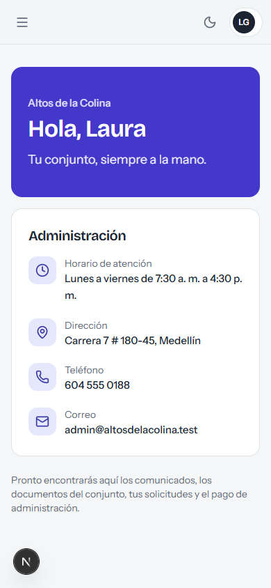

# Brisas — plataforma de gestión residencial

Plataforma SaaS para administrar varios conjuntos residenciales desde una sola instalación:
panel administrativo, portal de residentes y consola de plataforma, sobre una API REST segura
y una base de datos PostgreSQL con aislamiento por conjunto.

> **Estado: Fase 1 terminada** (fundamentos, autenticación, multi-conjunto, roles) más el
> registro de torres, unidades y residentes. El detalle de lo construido y lo pendiente está
> en [docs/06-roadmap.md](docs/06-roadmap.md).

## Empezar en 3 pasos

Requisito único: **Node.js 22 o superior**. No necesitas Docker ni instalar PostgreSQL: el
entorno de desarrollo trae un PostgreSQL real embebido.

```bash
npm install
npm install-scripts approve @embedded-postgres/windows-x64 esbuild   # solo npm 11+, una vez
npm run dev
```

`npm run dev` levanta la base de datos (puerto 54329), aplica las migraciones, carga datos de
demostración la primera vez, y arranca la API y la web.

| Qué | Dónde |
| --- | --- |
| Aplicación web | http://localhost:3000 |
| API | http://localhost:4000/api/v1 |
| Documentación OpenAPI (Swagger) | http://localhost:4000/api/docs |

### Cuentas de demostración

Contraseña de todas: `Brisas-Demo-2026`. Son **datos de demostración**, solo para desarrollo.

| Correo | Qué puedes probar |
| --- | --- |
| `admin.parque@brisas.test` | Panel administrativo de *Brisas del Parque* (2 torres, 40 apartamentos) |
| `admin.colina@brisas.test` | Panel administrativo de *Altos de la Colina* (12 casas) |
| `laura.gomez@brisas.test` | Una misma persona: propietaria en un conjunto y arrendataria en el otro |
| `superadmin@brisas.test` | Consola de plataforma: crear y desactivar conjuntos |

Los correos (invitaciones, recuperación de contraseña) no se envían en desarrollo: el enlace
aparece en la consola, en las líneas que empiezan por `[Correo]`.

## Así se ve

| Panel administrativo | Torres y unidades |
| --- | --- |
|  |  |

| Asistente de registro | Portal del residente |
| --- | --- |
|  |  |

## Comandos

| Comando | Qué hace |
| --- | --- |
| `npm run dev` | Base de datos + API + web, con recarga automática |
| `npm test` | Pruebas de contratos y de la API contra un PostgreSQL real y vacío |
| `npm run typecheck` | Verificación de tipos de todo el monorepo |
| `npm run build` | Compilación de producción |
| `npm run db:generate` | Genera una migración SQL a partir de cambios en el esquema |
| `npm run db:migrate` | Aplica migraciones, políticas de seguridad y catálogos |
| `npm run db:seed` | Carga los datos de demostración |
| `npm run openapi -w @brisas/api` | Regenera `docs/api/openapi.json` (requiere `npm run build` antes) |

## Estructura

```text
apps/
  api/          API REST (NestJS, monolito modular)
  web/          Web (Next.js): panel, portal de residentes y consola de plataforma
packages/
  contracts/    Esquemas Zod, tipos y catálogo de permisos compartidos por API, web y móvil
  database/     Esquema Drizzle, migraciones SQL, políticas RLS y datos iniciales
docs/           Arquitectura, modelo de datos, permisos, UX, seguridad, despliegue
infrastructure/ docker-compose alternativo
scripts/        Base de datos embebida de desarrollo
```

## Documentación

1. [Visión del producto](docs/01-vision-producto.md)
2. [Arquitectura y stack](docs/02-arquitectura.md)
3. [Modelo de datos](docs/03-modelo-datos.md)
4. [Roles y permisos](docs/04-roles-permisos.md)
5. [Diseño UX/UI](docs/05-ux-ui.md)
6. [Roadmap y estado](docs/06-roadmap.md)
7. [Seguridad y privacidad](docs/07-seguridad-privacidad.md)
8. [Instalación y despliegue](docs/08-instalacion-despliegue.md)
9. [API](docs/09-api.md) y [especificación OpenAPI](docs/api/openapi.json)
