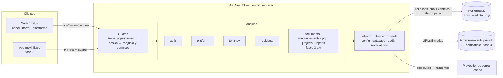
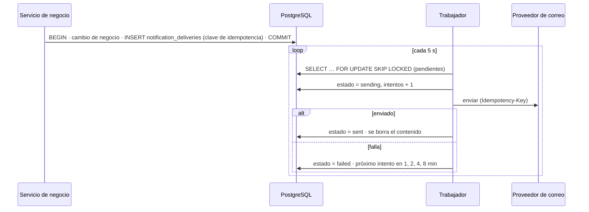

# 2. Arquitectura y stack

## Vista general



Una petición a `/tenants/{id}/residents` atraviesa, en orden:

1. **Límite de peticiones** por IP (más estricto en autenticación).
2. **AuthGuard**: valida la firma del access token *y* que la sesión siga viva en base de datos.
3. **TenantGuard**: el usuario debe ser miembro activo del conjunto, el conjunto debe estar
   activo y el rol debe incluir el permiso que declara la ruta. Sin permisos declarados, la ruta
   se rechaza por defecto.
4. **Validación** del cuerpo y los parámetros con el mismo esquema Zod que usa el formulario.
5. **Servicio**: abre una transacción que declara el conjunto ante PostgreSQL.
6. **Row Level Security**: la base de datos solo devuelve filas de ese conjunto.

## Stack elegido

| Capa | Elección | Por qué | Alternativa descartada |
| --- | --- | --- | --- |
| Lenguaje | TypeScript estricto en todo | Un solo lenguaje y contratos compartidos entre API, web y móvil | — |
| API | NestJS 11 | Módulos, guards e inyección de dependencias dan la estructura de un monolito modular sin inventarla | FastAPI: obligaría a duplicar contratos en dos lenguajes |
| Validación | Zod 4 en `packages/contracts` | El mismo esquema valida el formulario y el endpoint; los mensajes en español se escriben una vez | class-validator: no se puede compartir con el cliente |
| Base de datos | PostgreSQL 18 | RLS, claves compuestas, `FOR UPDATE SKIP LOCKED` para la cola | — |
| Acceso a datos | Drizzle ORM | SQL tipado y explícito; las migraciones son archivos SQL legibles; no oculta las transacciones que RLS necesita | Prisma: su modelo de conexión complica fijar el contexto por transacción |
| Web | Next.js 16 + React 19 + Tailwind 4 | App Router, proxy `/api` de mismo origen, componentes propios accesibles sobre Radix | — |
| Móvil (fase 7) | React Native con Expo | Reutiliza `contracts` y el cliente de API | Flutter: sin reutilización de tipos |
| Correo | Resend + cola en PostgreSQL | La cola outbox no añade infraestructura y es transaccional con el hecho de negocio | Redis/BullMQ: innecesario al volumen del MVP |
| Archivos (fase 3) | S3 compatible con URLs firmadas | Estándar, barato, portable | Supabase Storage: acopla a un proveedor |

### Decisiones que se apartan de la propuesta inicial

- **Una sola aplicación web** en lugar de `admin-web` y `resident-web`. El panel y el portal
  comparten sesión, componentes y despliegue; un mismo usuario puede ser administrador en un
  conjunto y residente en otro. Separarlas duplicaría el acceso y el sistema de diseño sin
  beneficio hoy. La ruta `/c/<conjunto>` muestra el panel o el portal según los permisos.
- **`packages/contracts`** reúne lo que la propuesta separaba en `types`, `validation` y
  `config`: son una sola cosa (el contrato) y se versionan juntas. `packages/ui` y
  `packages/api-client` se extraerán cuando exista un segundo consumidor (la app móvil).
- **`packages/database`** en lugar de una carpeta `database/` suelta, para que la API y los
  scripts importen el esquema como cualquier otra dependencia.
- **NestJS 11 y TypeScript 5.9**, no las versiones mayores más recientes (12 y 7), porque
  `nestjs-zod` aún no declara compatibilidad con ellas. Es una actualización pendiente.
- **npm workspaces**, sin herramienta adicional de monorepo: con cuatro paquetes no hace falta.

## Organización de la API

```text
apps/api/src/
  config/         Variables de entorno validadas al arrancar
  common/         Errores, filtro global, contexto de la petición, paginación
  database/       DatabaseService: transacciones con contexto de conjunto
  audit/          Bitácora (se escribe en la misma transacción que el cambio)
  notifications/  Cola de correos y transportes
  auth/           Sesiones, MFA, invitaciones, guards, identidad
  platform/       Conjuntos y planes (SuperAdmin)
  tenancy/        Información del conjunto, torres y unidades
  residents/      Personas, vinculaciones, acceso
```

Cada módulo de negocio tiene un controlador (HTTP, permisos, documentación), un servicio
(reglas y transacciones) y sus DTO (derivados de `contracts`). No hay capa de repositorios
separada: Drizzle ya es un constructor de consultas tipado y una capa más solo añadiría
indirección. Se introducirá donde una consulta se repita en varios servicios.

## Aislamiento entre conjuntos

Tres barreras independientes; cualquiera de ellas basta para detener una fuga:

1. **API**: `TenantGuard` exige pertenencia al conjunto de la URL. Responde 404, no 403, para
   no confirmar qué conjuntos existen.
2. **Row Level Security**: la API se conecta con el rol `brisas_app`, que no es dueño de las
   tablas. Cada transacción declara su conjunto con `set_config('app.tenant_id', …, true)` y
   una política por tabla filtra y valida cada fila. Una consulta que olvide el `WHERE` sigue
   devolviendo solo el conjunto correcto.
3. **Claves foráneas compuestas** `(tenant_id, id)`: una fila de un conjunto no puede
   referenciar a una de otro ni siquiera con privilegios de superusuario.

`app.apply_security()` recorre todas las tablas con columna `tenant_id` y les aplica la
política; se ejecuta en cada migración, así que una tabla nueva queda protegida aunque quien la
creó lo olvide. Una prueba verifica que no quede ninguna sin RLS.

**Límite conocido:** RLS protege contra errores de la aplicación, no contra una inyección SQL
que lograra ejecutar `set_config`. Por eso todas las consultas son parametrizadas.

## Notificaciones



- **Sin duplicados**: la clave de idempotencia identifica el hecho (`auth.invitation:<id>`);
  un segundo `INSERT` del mismo hecho no hace nada, y la misma clave viaja al proveedor.
- **Sin pérdidas**: el correo se encola en la misma transacción que el hecho; si el proceso
  muere a mitad de un envío, el trabajador lo retoma a los 5 minutos.
- **Varias instancias**: `SKIP LOCKED` evita que dos trabajadores tomen el mismo envío.
- **Plantillas** en base de datos, con una por defecto de la plataforma y la posibilidad de una
  propia por conjunto. Las variables se escapan al renderizar.
- Tras 5 intentos el envío queda `dead` para revisión. Las notificaciones push (fase 7)
  reutilizan la misma cola con otro canal.

## Almacenamiento de archivos (diseñado, se implementa en la fase 3)

- Un bucket **privado**; ningún archivo es público por URL.
- Clave `tenants/<tenant_id>/<tipo>/<uuid>`; una restricción de la tabla `attachments` impide
  guardar una clave fuera del prefijo del conjunto.
- **Subida**: la API valida tipo, tamaño y cantidad, crea la fila `pending` y entrega una URL
  firmada de subida de corta duración; al confirmar, verifica tamaño y tipo real (firma del
  archivo) antes de marcarla `ready`.
- **Descarga**: la API autoriza al usuario sobre el recurso dueño y entrega una URL firmada de
  60 segundos. Nunca se entrega la clave ni una URL permanente.
- Los originales de evidencias de PQR se conservan; las versiones comprimidas son derivadas.

## Observabilidad

- Cada petición recibe un `x-request-id` que aparece en los logs, en las respuestas de error y
  en la bitácora de auditoría.
- En producción los logs son JSON; no incluyen cadenas de consulta, contraseñas ni tokens.
- `GET /api/v1/health` verifica la conexión a la base de datos.
