# 3. Modelo de datos

La fuente de verdad es el esquema en [packages/database/src/schema](../packages/database/src/schema);
las migraciones SQL generadas están en [packages/database/migrations](../packages/database/migrations).
Las 36 tablas existen desde la primera migración, aunque los módulos de las fases 3 a 6 aún no
las usan: así el modelo se revisó completo y coherente antes de construir sobre él.

## Cinco conceptos que no se deben confundir

| Concepto | Tabla | Qué es |
| --- | --- | --- |
| **Usuario** | `users` | Una cuenta de acceso (correo y contraseña). Es global: no pertenece a ningún conjunto. |
| **Persona** | `persons` | Una persona natural registrada *en un conjunto*. Puede no tener cuenta. Se enlaza a un usuario con `user_id` cuando se le invita. |
| **Propiedad** | `properties` | Una unidad: apartamento, casa o local. |
| **Vinculación** | `property_occupancies` | La relación de una persona con una propiedad: propietario, arrendatario u otro autorizado, con fecha de inicio y de fin. |
| **Residente** | *(no es una tabla)* | Una persona con al menos una vinculación vigente (`end_date` nulo). |

Consecuencias: una persona puede estar vinculada a varias unidades; una unidad puede tener
varias personas; al terminar una vinculación la fila se conserva como **historial de
ocupación**; y un mismo usuario puede ser persona en dos conjuntos con roles distintos
(`user_tenant_memberships`).

## Diagrama entidad-relación

```mermaid
erDiagram
  plans ||--o{ tenants : "plan"
  tenants ||--|| tenant_settings : "personalización"
  tenants ||--o{ user_tenant_memberships : ""
  users ||--o{ user_tenant_memberships : ""
  roles ||--o{ user_tenant_memberships : ""
  roles ||--o{ role_permissions : ""
  permissions ||--o{ role_permissions : ""
  users ||--o{ user_sessions : ""
  users ||--o{ auth_tokens : ""
  users ||--o{ consents : ""

  tenants ||--o{ towers : ""
  towers ||--o{ properties : ""
  tenants ||--o{ persons : ""
  users |o--o{ persons : "cuenta opcional"
  persons ||--o{ property_occupancies : ""
  properties ||--o{ property_occupancies : ""
  properties |o--o{ parking_spaces : "asignado a"
  properties |o--o{ storage_units : "asignado a"
  properties ||--o{ pets : ""

  tenants ||--o{ document_categories : ""
  document_categories ||--o{ institutional_documents : ""
  institutional_documents ||--o{ document_versions : ""
  attachments ||--o{ document_versions : ""
  tenants ||--o{ announcements : ""
  announcements ||--o{ announcement_audiences : ""

  tenants ||--o{ maintenance_projects : ""
  maintenance_projects ||--o{ project_milestones : ""
  maintenance_projects ||--o{ project_updates : ""

  tenants ||--o{ pqrs : ""
  users ||--o{ pqrs : "solicitante"
  pqrs ||--o{ pqr_comments : ""
  pqrs ||--o{ pqr_status_history : ""

  tenants ||--o{ attachments : ""
  tenants ||--o{ notifications : ""
  tenants |o--o{ notification_templates : "propia o de plataforma"
  tenants |o--o{ notification_deliveries : ""
  tenants |o--o{ audit_logs : ""
  tenants ||--o{ data_subject_requests : ""
```

## Convenciones

| Aspecto | Regla |
| --- | --- |
| Clave primaria | `id uuid` con `gen_random_uuid()`. Excepciones: `permissions.key`, `tenant_settings.tenant_id`, claves compuestas en tablas de relación. |
| Aislamiento | Toda tabla de un conjunto tiene `tenant_id` y una política RLS `tenant_isolation`. |
| Integridad entre conjuntos | Las tablas hijas referencian al padre con `(tenant_id, id)`; el padre declara `UNIQUE (tenant_id, id)`. |
| Auditoría temporal | `created_at` y `updated_at` (`timestamptz`); `created_by` donde importa quién. |
| Borrado | Lógico (`deleted_at`) en personas, documentos y adjuntos; las unidades se desactivan (`is_active`). |
| Fechas de calendario | `date` (inicio y fin de vinculación, fechas de proyecto), sin zona horaria. |
| Estados | Tipos `enum` de PostgreSQL. |
| Texto único sin distinguir mayúsculas | Índice único sobre `lower(columna)`. |

## Entidades

**Política de acceso:** *conjunto* = RLS por `tenant_id`; *global* = sin RLS, solo la usa el
código de autenticación; *catálogo* = lectura para todos, escritura solo por migraciones.

### Plataforma e identidad

| Tabla | Campos principales | Restricciones e índices | Acceso |
| --- | --- | --- | --- |
| `plans` | `key`, `name`, `max_units`, `is_active` | `key` único | catálogo |
| `tenants` | `slug`, `name`, `tax_id`, `status`, `plan_id`→plans, `suspended_at` | `slug` único y con formato validado | lectura del propio; escritura solo plataforma |
| `tenant_settings` | PK `tenant_id`; `logo_attachment_id`, `primary_color`, `secondary_color`, `welcome_message`, `address`, `city`, `phones` jsonb, `whatsapp`, `email`, `website`, `office_hours`, `payment_url`, `timezone`, `privacy_policy_text` | Colores hexadecimales; `payment_url` solo `https://` | conjunto |
| `users` | `email`, `display_name`, `password_hash`, `status`, `is_platform_admin`, `mfa_enabled`, `mfa_secret_encrypted`, `mfa_recovery_code_hashes`, `failed_login_count`, `locked_until`, `last_login_at` | `lower(email)` único | global |
| `user_sessions` | `user_id`→users, `refresh_token_hash`, `previous_token_hash`, `client`, `user_agent`, `ip`, `last_used_at`, `expires_at`, `revoked_at`, `revoked_reason` | Hash único; índice parcial de sesiones vivas | global |
| `auth_tokens` | `user_id`, `tenant_id?`, `purpose`, `token_hash`, `expires_at`, `consumed_at` | Hash único | global |
| `roles` | `tenant_id?`, `key`, `name`, `is_system` | `(tenant_id, key)` único con nulos iguales | sistema: lectura; propios: conjunto |
| `permissions` | PK `key`, `description` | — | catálogo |
| `role_permissions` | PK `(role_id, permission_key)` | — | catálogo |
| `user_tenant_memberships` | `tenant_id`, `user_id`, `role_id`, `status`, `created_by` | `(user_id, tenant_id, role_id)` único | conjunto |
| `consents` | `user_id`, `tenant_id?`, `kind`, `policy_version`, `accepted_at`, `ip`, `user_agent` | Índice por usuario | global |
| `data_subject_requests` | `tenant_id`, `requester_user_id`, `type`, `status`, `details`, `resolution`, `due_at`, `resolved_at` | Índice `(tenant_id, status)` | conjunto |

### Residencial

| Tabla | Campos principales | Restricciones e índices | Acceso |
| --- | --- | --- | --- |
| `towers` | `name`, `kind`, `floors`, `sort_order` | `(tenant_id, lower(name))` único | conjunto |
| `properties` | `tower_id?`→towers, `kind`, `number`, `floor`, `area_m2`, `coefficient`, `is_active` | `(tenant_id, tower_id, number)` único; coeficiente entre 0 y 1 | conjunto |
| `persons` | `user_id?`→users, `first_name`, `last_name`, `email`, `phone`, `document_type`, `document_number`, `deleted_at` | Únicos parciales por correo, por documento y por usuario dentro del conjunto | conjunto |
| `property_occupancies` | `property_id`, `person_id`, `relationship`, `start_date`, `end_date`, `household_size`, `libertad_tradicion_available` | Único parcial `(property_id, person_id)` donde `end_date` es nulo; `end_date >= start_date` | conjunto |
| `parking_spaces` | `number`, `kind`, `property_id?` | `(tenant_id, lower(number))` único | conjunto |
| `storage_units` | `number`, `property_id?` | `(tenant_id, lower(number))` único | conjunto |
| `pets` | `property_id`, `owner_person_id?`, `species`, `breed`, `name`, `is_active` | Índice `(tenant_id, property_id)` | conjunto |

### Contenido, proyectos y PQR (fases 3 a 5)

| Tabla | Campos principales | Restricciones e índices | Acceso |
| --- | --- | --- | --- |
| `attachments` | `owner_type`, `owner_id`, `storage_key`, `original_name`, `mime_type`, `size_bytes`, `checksum_sha256`, `status` | `storage_key` único y dentro de `tenants/<tenant_id>/` | conjunto |
| `document_categories` | `name`, `sort_order`, `is_default` | `(tenant_id, lower(name))` único | conjunto |
| `institutional_documents` | `category_id`, `title`, `description`, `current_version_id`, `visible_to_roles` jsonb, `status`, `deleted_at` | Índice `(tenant_id, category_id, status)` | conjunto |
| `document_versions` | `document_id`, `version_number`, `attachment_id`, `change_note`, `uploaded_by` | `(document_id, version_number)` único | conjunto |
| `announcements` | `title`, `body_html`, `excerpt`, `cover_attachment_id`, `status`, `publish_at`, `published_at`, `is_featured`, `is_urgent`, `author_id` | Índice del muro `(tenant_id, status, published_at desc)` | conjunto |
| `announcement_audiences` | `announcement_id`, `audience_type`, `role_key?`, `tower_id?`, `property_id?` | El destino debe corresponder al tipo | conjunto |
| `maintenance_projects` | `name`, `description`, `category`, `responsible_name`, `start_date`, `estimated_end_date`, `actual_end_date`, `status`, `progress_percent`, `observations`, `is_published` | Avance entre 0 y 100; fechas coherentes | conjunto |
| `project_milestones` | `project_id`, `title`, `due_date`, `completed_at`, `sort_order` | Índice `(project_id, sort_order)` | conjunto |
| `project_updates` | `project_id`, `body`, `progress_percent`, `status`, `is_public`, `author_id` | Índice `(project_id, created_at desc)` | conjunto |
| `pqr_sequences` | PK `(tenant_id, year)`, `last_value` | Genera el consecutivo sin colisiones | conjunto |
| `pqrs` | `filing_number`, `type`, `category`, `subject`, `description`, `priority`, `status`, `requester_user_id`, `property_id?`, `assignee_user_id?`, `first_response_at`, `resolved_at`, `closed_at` | `(tenant_id, filing_number)` único con formato `PQR-AAAA-NNNNNN` | conjunto |
| `pqr_comments` | `pqr_id`, `author_user_id`, `body`, `is_internal` | Índice `(pqr_id, created_at)` | conjunto |
| `pqr_status_history` | `pqr_id`, `from_status`, `to_status`, `changed_by`, `note` | Solo inserción | conjunto |

### Notificaciones y auditoría

| Tabla | Campos principales | Restricciones e índices | Acceso |
| --- | --- | --- | --- |
| `notifications` | `user_id`, `type`, `title`, `body`, `data`, `read_at` | Índice `(tenant_id, user_id, created_at desc)` | conjunto |
| `notification_templates` | `tenant_id?`, `key`, `channel`, `subject`, `body_html`, `is_active` | `(tenant_id, key, channel)` único | plataforma: lectura; propias: conjunto |
| `notification_deliveries` | `tenant_id?`, `channel`, `template_key`, `recipient`, `payload`, `idempotency_key`, `status`, `attempts`, `next_attempt_at`, `last_error`, `sent_at` | `idempotency_key` único; índice parcial de pendientes | conjunto |
| `audit_logs` | `tenant_id?`, `actor_user_id`, `action`, `entity_type`, `entity_id`, `summary`, `changes`, `ip`, `user_agent`, `request_id` | Solo inserción (la API no tiene `UPDATE` ni `DELETE`) | conjunto |

## Migraciones

- `0000_initial_schema.sql` — generado por Drizzle a partir del esquema.
- `0001_security.sql` — escrito a mano: funciones de contexto, rol `brisas_app`, políticas RLS y
  permisos. Define `app.apply_security()`, que se vuelve a ejecutar tras cada migración.

Para cambiar el modelo: edita el esquema, ejecuta `npm run db:generate`, revisa el SQL generado
y aplícalo con `npm run db:migrate`.
