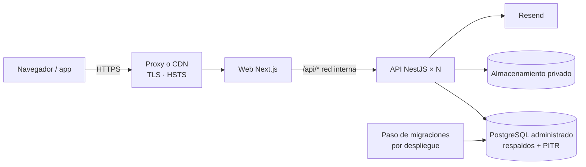

# 8. Instalación y despliegue

## Desarrollo local

**Requisito:** Node.js 22 o superior (probado con 24). Nada más.

```bash
git clone https://github.com/Alexanders1986/Brisas2.git
cd Brisas2
cp .env.example .env          # en Windows: copy .env.example .env
npm install
npm install-scripts approve @embedded-postgres/windows-x64 esbuild   # solo npm 11+
npm run dev
```

Con npm 11 o superior los scripts de instalación de las dependencias están bloqueados por
defecto. El segundo comando autoriza los dos que este proyecto necesita; en macOS o Linux
cambia `windows-x64` por tu plataforma (`darwin-arm64`, `linux-x64`…).

`npm run dev` hace cuatro cosas a la vez:

1. Inicia un **PostgreSQL embebido** en el puerto 54329 (datos en `.data/postgres`), aplica
   migraciones y carga los datos de demostración la primera vez.
2. Recompila `packages/contracts` y `packages/database` al cambiar.
3. Arranca la **API** en http://localhost:4000 (Swagger en `/api/docs`).
4. Arranca la **web** en http://localhost:3000.

Las cuentas de demostración están en el [README](../README.md#cuentas-de-demostración).

### Comprobar que todo funciona

```bash
npm run typecheck     # tipos de todo el monorepo
npm test              # 93 pruebas; usan su propio PostgreSQL, vacío, en el puerto 54330
npm run build         # compilación de producción
```

### Problemas frecuentes

| Síntoma | Causa y solución |
| --- | --- |
| `No fue posible iniciar la base de datos de desarrollo` | Quedó un proceso `postgres` de una ejecución anterior. Ciérralo desde el Administrador de tareas y vuelve a ejecutar. |
| La API no encuentra `dist/main` | Borra `apps/api/dist` y vuelve a ejecutar `npm run dev`. |
| `Configuración inválida` al arrancar | Falta o es incorrecta una variable de `.env`; el mensaje dice cuál. |
| Empezar de cero | Detén todo y borra la carpeta `.data`. |
| No llega el correo de invitación | En desarrollo no se envían correos: busca la línea `[Correo]` en la consola. |

### Con Docker en lugar de la base embebida

```bash
docker compose -f infrastructure/docker-compose.yml up -d
npm run build:packages && npm run db:migrate && npm run db:seed
npm run dev -w @brisas/api      # en una terminal
npm run dev -w @brisas/web      # en otra
```

## Variables de entorno

Documentadas en [.env.example](../.env.example). Las imprescindibles en producción:

| Variable | Descripción |
| --- | --- |
| `NODE_ENV` | `production` |
| `DATABASE_URL` | Conexión del rol `brisas_app` (sin privilegios, sujeto a RLS). |
| `DATABASE_ADMIN_URL` | Conexión del dueño del esquema. **Solo** para el paso de migraciones; no se entrega a la API. |
| `APP_DB_PASSWORD` | Contraseña que las migraciones asignan a `brisas_app`. |
| `JWT_ACCESS_SECRET` | Al menos 48 bytes aleatorios. |
| `DATA_ENCRYPTION_KEY` | 32 bytes aleatorios en base64 (cifra los secretos de dos pasos). Si se pierde, los usuarios deben reconfigurar la verificación. |
| `WEB_URL` | URL pública de la web, con HTTPS. Se usa en los enlaces de los correos. |
| `MFA_REQUIRED_FOR_ADMINS` | `true` |
| `MAIL_TRANSPORT`, `RESEND_API_KEY`, `MAIL_FROM` | `resend`, la clave y un remitente de un dominio verificado. |
| `TRUST_PROXY_HOPS` | Número de proxies delante de la API, para obtener la IP real del cliente. |
| `API_INTERNAL_URL` | (web) URL interna de la API a la que Next.js reenvía `/api/*`. |

Generar secretos:

```bash
node -e "console.log(require('crypto').randomBytes(48).toString('base64url'))"   # JWT
node -e "console.log(require('crypto').randomBytes(32).toString('base64'))"      # cifrado
```

La API se niega a arrancar en producción con los secretos de ejemplo, sin HTTPS en `WEB_URL` o
con el correo mal configurado.

## Despliegue

Esta sección describe la arquitectura de despliegue recomendada. **Aún no se ha desplegado en
ningún entorno**: es el trabajo de la fase 8.



1. **Base de datos**: PostgreSQL 16 o superior administrado (RDS, Cloud SQL, Neon, Supabase),
   con respaldos diarios y recuperación a un punto en el tiempo.
2. **Migraciones** como paso previo de cada despliegue, con `DATABASE_ADMIN_URL`:
   `npm run build:packages && npm run db:migrate`. Es idempotente: aplica lo pendiente,
   reaplica las políticas de seguridad y sincroniza permisos y roles.
3. **API**: `npm run build -w @brisas/api` y `node apps/api/dist/main.js`. Solo necesita
   `DATABASE_URL`. No debe ser accesible desde internet: la web le reenvía el tráfico.
4. **Web**: `npm run build -w @brisas/web` y `npm run start -w @brisas/web`, detrás de un proxy
   con TLS.
5. **Primer SuperAdmin**: se crea una sola vez directamente en la base de datos (una fila en
   `users` con `is_platform_admin = true` y `status = 'invited'`); luego esa persona usa
   "Olvidé mi contraseña" para activar su cuenta. Un comando para esto es tarea de la fase 8.

No ejecutes `npm run db:seed` en producción: carga cuentas de demostración con una contraseña
pública (el comando se niega si `NODE_ENV=production`).

## Integración continua

[.github/workflows/ci.yml](../.github/workflows/ci.yml) ejecuta tipos, pruebas y compilación en
cada cambio, con un PostgreSQL de servicio. Las pruebas detectan `TEST_DATABASE_ADMIN_URL` y
usan esa base en lugar de la embebida.

El flujo **no se ha ejecutado todavía en GitHub**; su modo de base de datos externa se verificó
localmente.
